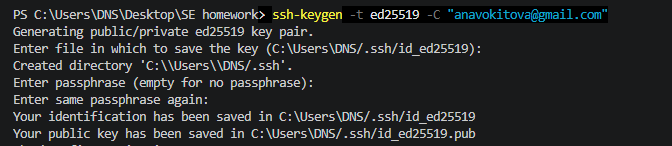
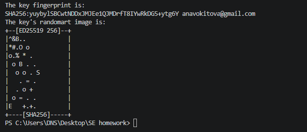
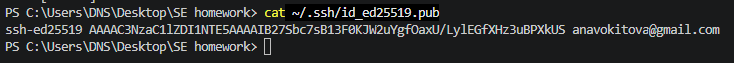
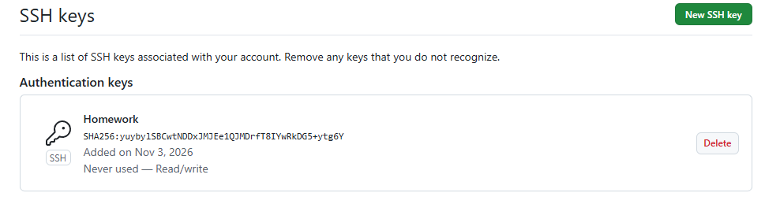
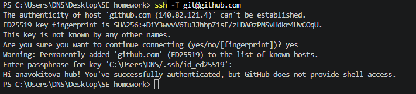
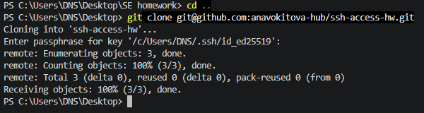
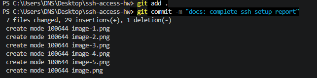
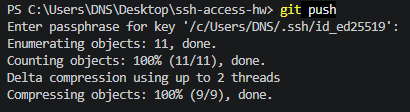

Добрый день! Выполняю домашнее задание

### 1. Генерация ключевой пары SSH (Ed25519)

Сгенерировала новую пару ключей алгоритма Ed25519 с паролем. Приватный ключ защищен паролем, а публичный ключ сохранен в директории

### 2. Добавление публичного ключа в аккаунт GitHub

Публичный ключ добавлен в настройках аккаунта GitHub

### 3. Проверка SSH-подключения к GitHub

Выполнена проверка подключения командой `ssh -T git@github.com`. Аутентификация прошла успешно.

### 4. Работа с репозиторием по SSH

Репозиторий склонирован по SSH-URL:
`git clone git@github.com:anavokitova-hub/ssh-access-hw.git`

Файлы отчета и скриншоты были зафиксированы и успешно отправлены на GitHub.

Операция `git push` была выполнена успешно. Аутентификация прошла автоматически через настроенный SSH-ключ Ed25519, без запроса логина и пароля от аккаунта GitHub.